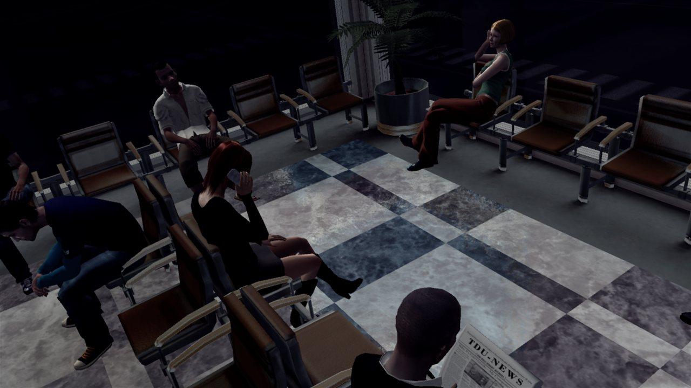

# Test Drive Unlimited Rewrite

**Test Drive Unlimited (Xbox 360, 2006), statically recompiled to native PC code.** The game's PowerPC executable is
translated to C++ with [ReXGlue](https://github.com/rexglue/rexglue-sdk) and built as a Windows program; the Xbox 360
system calls and GPU are provided by the ReXGlue runtime today and, step by step, by
[Any360](https://github.com/GaetanVigner/Any360), whose goal is a portable native codebase with no emulation layer left.

**This repository holds no game data and no game code.** You need your own copy of the game (European disc, title
494707D4); the recompiled C++ is generated on your machine from your disc's `default.xex`.

## Status

| | |
|---|---|
| Recompilation | `default.xex` fully translated (ReXGlue v0.10.0); 53 functions the analyzer misses are declared in [config/](config/) |
| Boot | reaches the airport intro on the ReXGlue runtime's GPU (Direct3D 12), with sound |
| Any360 | next: the GPU through `any360::gfx` (Vulkan), as in [Crackdown](https://github.com/GaetanVigner/CrackdownRewrite) and [The Simpsons Game](https://github.com/GaetanVigner/TheSimpsonsGameRewrite) |

## Building (Windows)

Needs Visual Studio 2022 with the C++ and Clang tools, and an install of the ReXGlue SDK v0.10.0 (`-Sdk`, the folder with
`bin\rexglue.exe`, `include\` and `lib\`).

1. Extract your disc into `game\` (for example with [extract-xiso](https://github.com/XboxDev/extract-xiso)), so that
   `game\default.xex` exists. A junction to a folder elsewhere works too.
2. `powershell -File codegen.ps1 -Sdk <sdk>` generates the C++ into `generated\default\`.
3. `powershell -File build.ps1 -Sdk <sdk>` builds `out\build\tdu.exe`.
4. Run `out\build\tdu.exe`. It finds `game\` next to itself or in the repository; `--game_data_root <dir>` points
   elsewhere. Logs are written to `out\build\logs\`.

## Finding missing functions

Code reached only through vtables or data pointers is invisible to the codegen's analysis; calling it ends in
`Call to invalid or unregistered function`. [tools/find-missing-functions.py](tools/find-missing-functions.py) scans
the decrypted image for such targets and writes the confident ones to
[config/discovered-functions.toml](config/discovered-functions.toml) (`--apply-high`); the image comes from
Crackdown's `dump_image` tool (`dump_image game default.xex out/image/default_image.bin`). Hand-found ones go in
[config/overrides.toml](config/overrides.toml).

## Why
I have a wish to return the amazing moments, when we was young.
When I was a child it was one of my favourite games, but when I hadn't been enough competent in PC, due to I hadn't played online mode,
but when I remembered about this game, it was to late, servers was closed...
I think, what I'm not alone with this wish...
Now I'm a programmer (in specialities of C++ 3D graphics and nets) and I've no through out this idea out of my mind. 
Then, I'll try to close this goal.

## Advantages of this project:
1)We can understand how works online mode and remake servers for PC and XBox 360

2)Easier and better modding with understanding of source code

3)Port of this game to Mac and Linux (later)

4)Possibility to create global mods for PC and XBox verison 

5)360-version have some new cars, which we are easier to convert to PC-version (and add new cars)

6)360 Graphics sometimes a bit better, due to special shaders (like mw 360 vs PC version)

7)Sequel maybe modified (at this moment fan-made online is not exist on XBOX 360 version, only on PC and PS3 versions) 

In conclusion, we will add 4K, RTX, DLSS and etc. cool modern things and solve the problems with online, traffic AI and CPU-usage

**This project is not a replacement for the game (you still need to own a legal copy of the game); and does not provide any game assets!**
**You should dump your DVD and prepare for this port**

XenonRecompUnlimited - it's special fork of XenonRecomp for TDU engine, like experimental fork-version with fresh updates
 (unfortunattely at this moment XenonRecomp updates long-term :( ) https://github.com/testdriveupgrade/XenonRecompUnlimited

