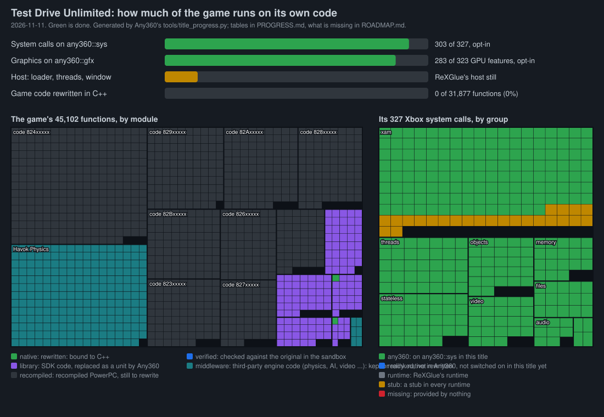

# Test Drive Unlimited: rewrite progress

Generated on 2026-11-10 by [Any360](https://github.com/GaetanVigner/Any360)'s `tools/title_progress.py`. What is still missing, step by step: [ROADMAP.md](ROADMAP.md). Every function: [functions.csv](functions.csv). Counts: [progress.json](progress.json).

## Where it stands

| Axis | Done | Of | Share | Notes |
|---|---|---|---|---|
| System calls on `any360::sys` | 23 | 327 | 7.0% | not switched on yet (Any360 step 11); only the video calls go through Any360, with the graphics binding |
| Graphics on `any360::gfx` (GPU features Any360 handles) | 283 | 323 | 88% | opt-in on `master`: `--any360_gpu=true` (`--any360_gpu_scale=2 --any360_gpu_msaa=4`, `--any360_gpu_vblank_hz=240` for up to 120 FPS); 83-115 FPS driving at 2x with 4x MSAA on an RTX 5070 Ti, against 54-85 for the runtime's GPU at 2x |
| Host (XEX loader, address space, threads, window, input, audio output) | 0 | 2 | 0% | ReXGlue's host runs the title; Any360 steps 13 and 14 |
| Game functions rewritten in C++ | 0 | 45,102 | 0% | 0 more verified against the original in the sandbox |
| Library functions (SDK, middleware) replaced | 0 | 0 | 0% | replaced as units, not decompiled |
| Instructions of rewritten functions | 0 | 1,999,820 | 0% | PowerPC instructions of the original |

## System calls

The 327 kernel and XAM functions the title imports, by the group a title switches to `any360::sys` at once. **any360**: on any360::sys in this title. **ready**: native in Any360, not switched on in this title yet. **runtime**: ReXGlue's runtime. **stub**: a stub in every runtime. **missing**: provided by nothing.

| Group | any360 | ready | runtime | stub | missing | Total |
|---|---|---|---|---|---|---|
| stateless | 0 | 33 | 0 | 0 | 0 | 33 |
| files | 0 | 15 | 0 | 0 | 0 | 15 |
| objects | 0 | 27 | 0 | 0 | 0 | 27 |
| threads | 0 | 35 | 0 | 0 | 0 | 35 |
| memory | 0 | 18 | 0 | 0 | 0 | 18 |
| xam | 0 | 139 | 0 | 25 | 0 | 164 |
| input | 0 | 4 | 0 | 0 | 0 | 4 |
| audio | 0 | 8 | 0 | 0 | 0 | 8 |
| video | 23 | 0 | 0 | 0 | 0 | 23 |

Every call

| Group | Library | Function | State |
|---|---|---|---|
| stateless | xboxkrnl | `DbgBreakPoint` | ready |
| stateless | xboxkrnl | `DbgPrint` | ready |
| stateless | xboxkrnl | `ExGetXConfigSetting` | ready |
| stateless | xboxkrnl | `KeBugCheck` | ready |
| stateless | xboxkrnl | `KeBugCheckEx` | ready |
| stateless | xboxkrnl | `KeEnableFpuExceptions` | ready |
| stateless | xboxkrnl | `RtlCaptureContext` | ready |
| stateless | xboxkrnl | `RtlCompareMemory` | ready |
| stateless | xboxkrnl | `RtlCompareMemoryUlong` | ready |
| stateless | xboxkrnl | `RtlFillMemoryUlong` | ready |
| stateless | xboxkrnl | `RtlImageXexHeaderField` | ready |
| stateless | xboxkrnl | `RtlInitAnsiString` | ready |
| stateless | xboxkrnl | `RtlInitUnicodeString` | ready |
| stateless | xboxkrnl | `RtlMultiByteToUnicodeN` | ready |
| stateless | xboxkrnl | `RtlNtStatusToDosError` | ready |
| stateless | xboxkrnl | `RtlRaiseException` | ready |
| stateless | xboxkrnl | `RtlTimeFieldsToTime` | ready |
| stateless | xboxkrnl | `RtlTimeToTimeFields` | ready |
| stateless | xboxkrnl | `RtlUnicodeToMultiByteN` | ready |
| stateless | xboxkrnl | `RtlUnwind` | ready |
| stateless | xam | `XGetAVPack` | ready |
| stateless | xam | `XGetGameRegion` | ready |
| stateless | xam | `XGetLanguage` | ready |
| stateless | xam | `XamGetExecutionId` | ready |
| stateless | xam | `XamGetSystemVersion` | ready |
| stateless | xam | `XamVoiceClose` | ready |
| stateless | xam | `XamVoiceCreate` | ready |
| stateless | xam | `XamVoiceHeadsetPresent` | ready |
| stateless | xam | `XamVoiceSubmitPacket` | ready |
| stateless | xboxkrnl | `__C_specific_handler` | ready |
| stateless | xboxkrnl | `_vsnprintf` | ready |
| stateless | xboxkrnl | `sprintf` | ready |
| stateless | xboxkrnl | `vsprintf` | ready |
| files | xboxkrnl | `NtCreateFile` | ready |
| files | xboxkrnl | `NtCreateIoCompletion` | ready |
| files | xboxkrnl | `NtDeviceIoControlFile` | ready |
| files | xboxkrnl | `NtFlushBuffersFile` | ready |
| files | xboxkrnl | `NtOpenFile` | ready |
| files | xboxkrnl | `NtQueryDirectoryFile` | ready |
| files | xboxkrnl | `NtQueryInformationFile` | ready |
| files | xboxkrnl | `NtQueryVolumeInformationFile` | ready |
| files | xboxkrnl | `NtReadFile` | ready |
| files | xboxkrnl | `NtReadFileScatter` | ready |
| files | xboxkrnl | `NtRemoveIoCompletion` | ready |
| files | xboxkrnl | `NtSetInformationFile` | ready |
| files | xboxkrnl | `NtSetIoCompletion` | ready |
| files | xboxkrnl | `NtWriteFile` | ready |
| files | xboxkrnl | `NtWriteFileGather` | ready |
| objects | xboxkrnl | `KeInitializeSemaphore` | ready |
| objects | xboxkrnl | `KeReleaseSemaphore` | ready |
| objects | xboxkrnl | `KeResetEvent` | ready |
| objects | xboxkrnl | `KeSetEvent` | ready |
| objects | xboxkrnl | `KeWaitForMultipleObjects` | ready |
| objects | xboxkrnl | `KeWaitForSingleObject` | ready |
| objects | xboxkrnl | `NtCancelTimer` | ready |
| objects | xboxkrnl | `NtClearEvent` | ready |
| objects | xboxkrnl | `NtClose` | ready |
| objects | xboxkrnl | `NtCreateEvent` | ready |
| objects | xboxkrnl | `NtCreateMutant` | ready |
| objects | xboxkrnl | `NtCreateSemaphore` | ready |
| objects | xboxkrnl | `NtCreateTimer` | ready |
| objects | xboxkrnl | `NtDuplicateObject` | ready |
| objects | xboxkrnl | `NtPulseEvent` | ready |
| objects | xboxkrnl | `NtReleaseMutant` | ready |
| objects | xboxkrnl | `NtReleaseSemaphore` | ready |
| objects | xboxkrnl | `NtSetEvent` | ready |
| objects | xboxkrnl | `NtSetTimerEx` | ready |
| objects | xboxkrnl | `NtSignalAndWaitForSingleObjectEx` | ready |
| objects | xboxkrnl | `NtWaitForMultipleObjectsEx` | ready |
| objects | xboxkrnl | `NtWaitForSingleObjectEx` | ready |
| objects | xboxkrnl | `ObDereferenceObject` | ready |
| objects | xboxkrnl | `ObLookupThreadByThreadId` | ready |
| objects | xboxkrnl | `ObOpenObjectByName` | ready |
| objects | xboxkrnl | `ObOpenObjectByPointer` | ready |
| objects | xboxkrnl | `ObReferenceObjectByHandle` | ready |
| threads | xboxkrnl | `ExCreateThread` | ready |
| threads | xboxkrnl | `ExTerminateThread` | ready |
| threads | xboxkrnl | `HalReturnToFirmware` | ready |
| threads | xboxkrnl | `KeAcquireSpinLockAtRaisedIrql` | ready |
| threads | xboxkrnl | `KeDelayExecutionThread` | ready |
| threads | xboxkrnl | `KeEnterCriticalRegion` | ready |
| threads | xboxkrnl | `KeGetCurrentProcessType` | ready |
| threads | xboxkrnl | `KeLeaveCriticalRegion` | ready |
| threads | xboxkrnl | `KeQueryBasePriorityThread` | ready |
| threads | xboxkrnl | `KeQueryPerformanceFrequency` | ready |
| threads | xboxkrnl | `KeQuerySystemTime` | ready |
| threads | xboxkrnl | `KeRaiseIrqlToDpcLevel` | ready |
| threads | xboxkrnl | `KeReleaseSpinLockFromRaisedIrql` | ready |
| threads | xboxkrnl | `KeResumeThread` | ready |
| threads | xboxkrnl | `KeSetAffinityThread` | ready |
| threads | xboxkrnl | `KeSetBasePriorityThread` | ready |
| threads | xboxkrnl | `KeSetDisableBoostThread` | ready |
| threads | xboxkrnl | `KeTlsAlloc` | ready |
| threads | xboxkrnl | `KeTlsFree` | ready |
| threads | xboxkrnl | `KeTlsGetValue` | ready |
| threads | xboxkrnl | `KeTlsSetValue` | ready |
| threads | xboxkrnl | `KeTryToAcquireSpinLockAtRaisedIrql` | ready |
| threads | xboxkrnl | `KfAcquireSpinLock` | ready |
| threads | xboxkrnl | `KfLowerIrql` | ready |
| threads | xboxkrnl | `KfReleaseSpinLock` | ready |
| threads | xboxkrnl | `KiApcNormalRoutineNop` | ready |
| threads | xboxkrnl | `NtQueueApcThread` | ready |
| threads | xboxkrnl | `NtResumeThread` | ready |
| threads | xboxkrnl | `NtSuspendThread` | ready |
| threads | xboxkrnl | `RtlEnterCriticalSection` | ready |
| threads | xboxkrnl | `RtlInitializeCriticalSection` | ready |
| threads | xboxkrnl | `RtlInitializeCriticalSectionAndSpinCount` | ready |
| threads | xboxkrnl | `RtlLeaveCriticalSection` | ready |
| threads | xboxkrnl | `RtlTryEnterCriticalSection` | ready |
| threads | xboxkrnl | `XexUnloadImageAndExitThread` | ready |
| memory | xboxkrnl | `ExAllocatePoolWithTag` | ready |
| memory | xboxkrnl | `ExFreePool` | ready |
| memory | xboxkrnl | `KeLockL2` | ready |
| memory | xboxkrnl | `KeUnlockL2` | ready |
| memory | xboxkrnl | `MmAllocatePhysicalMemory` | ready |
| memory | xboxkrnl | `MmAllocatePhysicalMemoryEx` | ready |
| memory | xboxkrnl | `MmFreePhysicalMemory` | ready |
| memory | xboxkrnl | `MmGetPhysicalAddress` | ready |
| memory | xboxkrnl | `MmQueryAddressProtect` | ready |
| memory | xboxkrnl | `MmQueryAllocationSize` | ready |
| memory | xboxkrnl | `MmSetAddressProtect` | ready |
| memory | xboxkrnl | `NtAllocateVirtualMemory` | ready |
| memory | xboxkrnl | `NtFreeVirtualMemory` | ready |
| memory | xboxkrnl | `NtQueryVirtualMemory` | ready |
| memory | xboxkrnl | `RtlFreeAnsiString` | ready |
| memory | xboxkrnl | `RtlUnicodeStringToAnsiString` | ready |
| memory | xam | `XamAlloc` | ready |
| memory | xam | `XamFree` | ready |
| xam | xboxkrnl | `ExRegisterTitleTerminateNotification` | ready |
| xam | xam | `NetDll_WSACancelOverlappedIO` | ready |
| xam | xam | `NetDll_WSACleanup` | ready |
| xam | xam | `NetDll_WSACloseEvent` | ready |
| xam | xam | `NetDll_WSACreateEvent` | ready |
| xam | xam | `NetDll_WSAEventSelect` | ready |
| xam | xam | `NetDll_WSAGetLastError` | ready |
| xam | xam | `NetDll_WSAGetOverlappedResult` | ready |
| xam | xam | `NetDll_WSARecv` | ready |
| xam | xam | `NetDll_WSARecvFrom` | ready |
| xam | xam | `NetDll_WSAResetEvent` | ready |
| xam | xam | `NetDll_WSASend` | ready |
| xam | xam | `NetDll_WSASendTo` | ready |
| xam | xam | `NetDll_WSASetEvent` | ready |
| xam | xam | `NetDll_WSASetLastError` | ready |
| xam | xam | `NetDll_WSAStartup` | ready |
| xam | xam | `NetDll_WSAWaitForMultipleEvents` | ready |
| xam | xam | `NetDll_XNetCleanup` | ready |
| xam | xam | `NetDll_XNetConnect` | ready |
| xam | xam | `NetDll_XNetCreateKey` | ready |
| xam | xam | `NetDll_XNetDnsLookup` | ready |
| xam | xam | `NetDll_XNetDnsRelease` | ready |
| xam | xam | `NetDll_XNetGetBroadcastVersionStatus` | ready |
| xam | xam | `NetDll_XNetGetConnectStatus` | ready |
| xam | xam | `NetDll_XNetGetDebugXnAddr` | ready |
| xam | xam | `NetDll_XNetGetEthernetLinkStatus` | ready |
| xam | xam | `NetDll_XNetGetOpt` | ready |
| xam | xam | `NetDll_XNetGetTitleXnAddr` | ready |
| xam | xam | `NetDll_XNetInAddrToServer` | ready |
| xam | xam | `NetDll_XNetInAddrToString` | ready |
| xam | xam | `NetDll_XNetInAddrToXnAddr` | ready |
| xam | xam | `NetDll_XNetQosGetListenStats` | ready |
| xam | xam | `NetDll_XNetQosListen` | ready |
| xam | xam | `NetDll_XNetQosLookup` | ready |
| xam | xam | `NetDll_XNetQosRelease` | ready |
| xam | xam | `NetDll_XNetQosServiceLookup` | ready |
| xam | xam | `NetDll_XNetRandom` | ready |
| xam | xam | `NetDll_XNetRegisterKey` | ready |
| xam | xam | `NetDll_XNetServerToInAddr` | ready |
| xam | xam | `NetDll_XNetSetOpt` | ready |
| xam | xam | `NetDll_XNetStartup` | ready |
| xam | xam | `NetDll_XNetTsAddrToInAddr` | ready |
| xam | xam | `NetDll_XNetUnregisterInAddr` | ready |
| xam | xam | `NetDll_XNetUnregisterKey` | ready |
| xam | xam | `NetDll_XNetXnAddrToInAddr` | ready |
| xam | xam | `NetDll_XNetXnAddrToMachineId` | ready |
| xam | xam | `NetDll_XnpCapture` | stub |
| xam | xam | `NetDll_XnpConfig` | stub |
| xam | xam | `NetDll_XnpConfigUPnP` | stub |
| xam | xam | `NetDll_XnpEthernetInterceptRecv` | stub |
| xam | xam | `NetDll_XnpEthernetInterceptSetCallbacks` | stub |
| xam | xam | `NetDll_XnpEthernetInterceptXmit` | stub |
| xam | xam | `NetDll_XnpGetActiveSocketList` | stub |
| xam | xam | `NetDll_XnpGetConfigStatus` | stub |
| xam | xam | `NetDll_XnpGetVlanXboxName` | stub |
| xam | xam | `NetDll_XnpLoadConfigParams` | stub |
| xam | xam | `NetDll_XnpLoadMachineAccount` | stub |
| xam | xam | `NetDll_XnpLogonClearQEvent` | stub |
| xam | xam | `NetDll_XnpLogonGetQFlags` | stub |
| xam | xam | `NetDll_XnpLogonGetQVals` | stub |
| xam | xam | `NetDll_XnpLogonGetStatus` | stub |
| xam | xam | `NetDll_XnpLogonSetPState` | stub |
| xam | xam | `NetDll_XnpLogonSetQEvent` | stub |
| xam | xam | `NetDll_XnpLogonSetQFlags` | stub |
| xam | xam | `NetDll_XnpLogonSetQVals` | stub |
| xam | xam | `NetDll_XnpNoteSystemTime` | stub |
| xam | xam | `NetDll_XnpRegisterKeyForCallerType` | stub |
| xam | xam | `NetDll_XnpSaveConfigParams` | stub |
| xam | xam | `NetDll_XnpSaveMachineAccount` | stub |
| xam | xam | `NetDll_XnpSetVlanXboxName` | stub |
| xam | xam | `NetDll_XnpUnregisterKeyForCallerType` | stub |
| xam | xam | `NetDll___WSAFDIsSet` | ready |
| xam | xam | `NetDll_accept` | ready |
| xam | xam | `NetDll_bind` | ready |
| xam | xam | `NetDll_closesocket` | ready |
| xam | xam | `NetDll_connect` | ready |
| xam | xam | `NetDll_getpeername` | ready |
| xam | xam | `NetDll_getsockname` | ready |
| xam | xam | `NetDll_getsockopt` | ready |
| xam | xam | `NetDll_inet_addr` | ready |
| xam | xam | `NetDll_ioctlsocket` | ready |
| xam | xam | `NetDll_listen` | ready |
| xam | xam | `NetDll_recv` | ready |
| xam | xam | `NetDll_recvfrom` | ready |
| xam | xam | `NetDll_select` | ready |
| xam | xam | `NetDll_send` | ready |
| xam | xam | `NetDll_sendto` | ready |
| xam | xam | `NetDll_setsockopt` | ready |
| xam | xam | `NetDll_shutdown` | ready |
| xam | xam | `NetDll_socket` | ready |
| xam | xam | `Refresh` | ready |
| xam | xam | `XMsgCancelIORequest` | ready |
| xam | xam | `XMsgInProcessCall` | ready |
| xam | xam | `XMsgStartIORequest` | ready |
| xam | xam | `XMsgStartIORequestEx` | ready |
| xam | xam | `XMsgSystemProcessCall` | ready |
| xam | xam | `XNetLogonGetMachineID` | ready |
| xam | xam | `XNetLogonGetTitleID` | ready |
| xam | xam | `XNotifyGetNext` | ready |
| xam | xam | `XNotifyPositionUI` | ready |
| xam | xam | `XamContentClose` | ready |
| xam | xam | `XamContentCreate` | ready |
| xam | xam | `XamContentCreateDeviceEnumerator` | ready |
| xam | xam | `XamContentCreateEnumerator` | ready |
| xam | xam | `XamContentCreateEx` | ready |
| xam | xam | `XamContentDelete` | ready |
| xam | xam | `XamContentFlush` | ready |
| xam | xam | `XamContentGetCreator` | ready |
| xam | xam | `XamContentGetDeviceData` | ready |
| xam | xam | `XamContentGetDeviceName` | ready |
| xam | xam | `XamContentGetDeviceState` | ready |
| xam | xam | `XamContentGetLicenseMask` | ready |
| xam | xam | `XamContentGetThumbnail` | ready |
| xam | xam | `XamContentInstall` | ready |
| xam | xam | `XamContentLaunchImage` | ready |
| xam | xam | `XamContentResolve` | ready |
| xam | xam | `XamContentSetThumbnail` | ready |
| xam | xam | `XamCreateEnumeratorHandle` | ready |
| xam | xam | `XamEnumerate` | ready |
| xam | xam | `XamGetPrivateEnumStructureFromHandle` | ready |
| xam | xam | `XamLoaderLaunchTitle` | ready |
| xam | xam | `XamLoaderTerminateTitle` | ready |
| xam | xam | `XamNotifyCreateListener` | ready |
| xam | xam | `XamParseGamerTileKey` | ready |
| xam | xam | `XamReadTileToTexture` | ready |
| xam | xam | `XamSessionCreateHandle` | ready |
| xam | xam | `XamSessionRefObjByHandle` | ready |
| xam | xam | `XamShowAchievementsUI` | ready |
| xam | xam | `XamShowDeviceSelectorUI` | ready |
| xam | xam | `XamShowDirtyDiscErrorUI` | ready |
| xam | xam | `XamShowFriendRequestUI` | ready |
| xam | xam | `XamShowFriendsUI` | ready |
| xam | xam | `XamShowGameInviteUI` | ready |
| xam | xam | `XamShowGamerCardUIForXUID` | ready |
| xam | xam | `XamShowKeyboardUI` | ready |
| xam | xam | `XamShowMarketplaceUI` | ready |
| xam | xam | `XamShowMessageBoxUI` | ready |
| xam | xam | `XamShowMessageBoxUIEx` | ready |
| xam | xam | `XamShowMessageComposeUI` | ready |
| xam | xam | `XamShowMessagesUI` | ready |
| xam | xam | `XamShowPlayerReviewUI` | ready |
| xam | xam | `XamShowPlayersUI` | ready |
| xam | xam | `XamShowQuickChatUI` | ready |
| xam | xam | `XamShowSigninUI` | ready |
| xam | xam | `XamShowSigninUIp` | ready |
| xam | xam | `XamShowVoiceMailUI` | ready |
| xam | xam | `XamUserAreUsersFriends` | ready |
| xam | xam | `XamUserCheckPrivilege` | ready |
| xam | xam | `XamUserCreateAchievementEnumerator` | ready |
| xam | xam | `XamUserCreateStatsEnumerator` | ready |
| xam | xam | `XamUserGetMembershipTierFromXUID` | ready |
| xam | xam | `XamUserGetName` | ready |
| xam | xam | `XamUserGetOnlineCountryFromXUID` | ready |
| xam | xam | `XamUserGetSigninState` | ready |
| xam | xam | `XamUserGetXUID` | ready |
| xam | xam | `XamUserReadProfileSettings` | ready |
| xam | xam | `XamUserWriteProfileSettings` | ready |
| xam | xam | `XamWriteGamerTile` | ready |
| xam | xboxkrnl | `XexCheckExecutablePrivilege` | ready |
| xam | xboxkrnl | `XexGetModuleHandle` | ready |
| xam | xboxkrnl | `XexGetModuleSection` | ready |
| xam | xboxkrnl | `XexGetProcedureAddress` | ready |
| xam | xboxkrnl | `XexLoadImage` | ready |
| xam | xboxkrnl | `XexUnloadImage` | ready |
| input | xam | `XamInputGetCapabilities` | ready |
| input | xam | `XamInputGetKeystrokeEx` | ready |
| input | xam | `XamInputGetState` | ready |
| input | xam | `XamInputSetState` | ready |
| audio | xboxkrnl | `XAudioGetVoiceCategoryVolume` | ready |
| audio | xboxkrnl | `XAudioGetVoiceCategoryVolumeChangeMask` | ready |
| audio | xboxkrnl | `XAudioQueryDriverPerformance` | ready |
| audio | xboxkrnl | `XAudioRegisterRenderDriverClient` | ready |
| audio | xboxkrnl | `XAudioSubmitRenderDriverFrame` | ready |
| audio | xboxkrnl | `XAudioUnregisterRenderDriverClient` | ready |
| audio | xboxkrnl | `XMACreateContext` | ready |
| audio | xboxkrnl | `XMAReleaseContext` | ready |
| video | xboxkrnl | `VdCallGraphicsNotificationRoutines` | any360 |
| video | xboxkrnl | `VdEnableDisableClockGating` | any360 |
| video | xboxkrnl | `VdEnableRingBufferRPtrWriteBack` | any360 |
| video | xboxkrnl | `VdGetCurrentDisplayGamma` | any360 |
| video | xboxkrnl | `VdGetCurrentDisplayInformation` | any360 |
| video | xboxkrnl | `VdGetSystemCommandBuffer` | any360 |
| video | xboxkrnl | `VdInitializeEngines` | any360 |
| video | xboxkrnl | `VdInitializeRingBuffer` | any360 |
| video | xboxkrnl | `VdInitializeScalerCommandBuffer` | any360 |
| video | xboxkrnl | `VdIsHSIOTrainingSucceeded` | any360 |
| video | xboxkrnl | `VdPersistDisplay` | any360 |
| video | xboxkrnl | `VdQuerySystemCommandBuffer` | any360 |
| video | xboxkrnl | `VdQueryVideoFlags` | any360 |
| video | xboxkrnl | `VdQueryVideoMode` | any360 |
| video | xboxkrnl | `VdRetrainEDRAM` | any360 |
| video | xboxkrnl | `VdRetrainEDRAMWorker` | any360 |
| video | xboxkrnl | `VdSetDisplayMode` | any360 |
| video | xboxkrnl | `VdSetGraphicsInterruptCallback` | any360 |
| video | xboxkrnl | `VdSetSystemCommandBuffer` | any360 |
| video | xboxkrnl | `VdSetSystemCommandBufferGpuIdentifierAddress` | any360 |
| video | xboxkrnl | `VdShutdownEngines` | any360 |
| video | xboxkrnl | `VdSwap` | any360 |
| video | xam | `XGetVideoMode` | any360 |

## Graphics

What `any360::gfx` handles of the Xbox 360 GPU (the same for every title; a title uses a part of it). In this title: opt-in on `master`: `--any360_gpu=true` (`--any360_gpu_scale=2 --any360_gpu_msaa=4`, `--any360_gpu_vblank_hz=240` for up to 120 FPS); 83-115 FPS driving at 2x with 4x MSAA on an RTX 5070 Ti, against 54-85 for the runtime's GPU at 2x.

| Family | Native | Not yet | Total |
|---|---|---|---|
| command processor | 43 | 7 | 50 |
| primitive types | 11 | 8 | 19 |
| render features | 54 | 1 | 55 |
| render target formats | 14 | 0 | 14 |
| shader ALU scalar | 50 | 0 | 50 |
| shader ALU vector | 30 | 0 | 30 |
| shader control flow | 16 | 0 | 16 |
| shader fetch | 9 | 0 | 9 |
| texture formats | 41 | 23 | 64 |
| vertex formats | 15 | 1 | 16 |

## Game code

Every function of the executable by module (named address ranges; the rest by 1 MB area until symbol recovery names them). **native**: rewritten: bound to C++. **verified**: checked against the original in the sandbox. **library**: SDK or middleware code, replaced as a unit. **recompiled**: recompiled PowerPC, still to rewrite.

| Module | Kind | Functions | Instructions | Native | Verified | Still recompiled | Native share |
|---|---|---|---|---|---|---|---|
| code 826xxxxx | game | 6,513 | 267,596 | 0 | 0 | 6,513 | 0% |
| code 82Axxxxx | game | 3,557 | 259,803 | 0 | 0 | 3,557 | 0% |
| code 828xxxxx | game | 3,084 | 259,750 | 0 | 0 | 3,084 | 0% |
| code 829xxxxx | game | 3,669 | 259,575 | 0 | 0 | 3,669 | 0% |
| code 824xxxxx | game | 9,336 | 258,686 | 0 | 0 | 9,336 | 0% |
| code 827xxxxx | game | 5,534 | 258,193 | 0 | 0 | 5,534 | 0% |
| code 825xxxxx | game | 7,326 | 257,298 | 0 | 0 | 7,326 | 0% |
| code 82Bxxxxx | game | 3,188 | 147,299 | 0 | 0 | 3,188 | 0% |
| code 823xxxxx | game | 2,895 | 31,620 | 0 | 0 | 2,895 | 0% |

The 0 rewritten functions

| Address | Module | Instructions | Handler | File |
|---|---|---|---|---|

## Host

Any360's own steps towards hosting a title without ReXGlue's runtime ([Any360 README](https://github.com/GaetanVigner/Any360#state)).

| Step | What | State |
|---|---|---|
| 9 | no call reaching the runtime: every path, the raw hard drive devices, the profile defaults on `any360::sys` | done (Crackdown; the host stays ReXGlue's until step 13) |
| 10 | a second title (The Simpsons Game) on the full system binding | done (all groups, levels, saves, sound, gamepad) |
| 11 | third and fourth titles (Test Drive Unlimited, Sonic 06) | not started |
| 12 | paths no title took yet: `XMA*` decoding, STFS packages, several users, guide UIs, Live offline, xbdm | partial: 602 of 2,914 exports native with scenario tests, none of the 2,294 reference stubs sorted |
| 13 | Any360's own host: XEX loader, address space, threads, guest dispatch, MMIO, devices | not started |
| 14 | the platform layer: window, input, audio, presenter on Windows and Linux (Steam Deck) | partial: SDL3 audio output only |
| 15 | graphics through `any360::gfx` only, no `rexgpu-xenos` | partial: three titles draw through `any360::gfx`, the GPU session's plan in [docs/GFX.md](https://github.com/GaetanVigner/Any360/blob/main/docs/GFX.md) |
| 16 | porting a new title: a converter served from GitHub (as AnyPS5) and built into the cross-platform launcher, from a XEX to a running build with no title-specific code in Any360 | not started |
